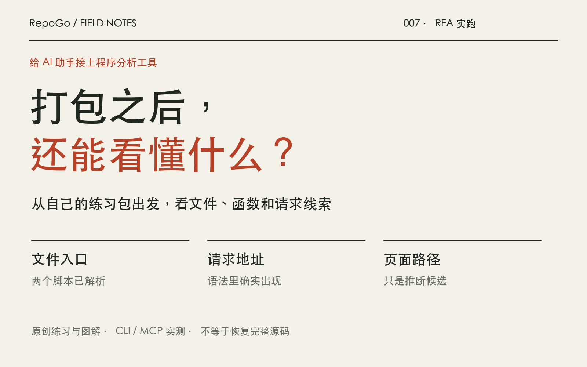

# 让 AI 帮你看懂打包后的程序

RepoGo 原创中文运行练习，基于 [morluto/rea](https://github.com/morluto/rea) 的 `rea-agents@6.8.0`。从 [START_HERE.md](START_HERE.md) 开始。

交付包含原创假样例、一键入口、中文结果查看页和排错说明。上游已有中文文档，本项目不声称完成 REA 界面汉化，不捆绑 REA 程序。运行时通过 npm 官方 registry 安装锁定版本。

