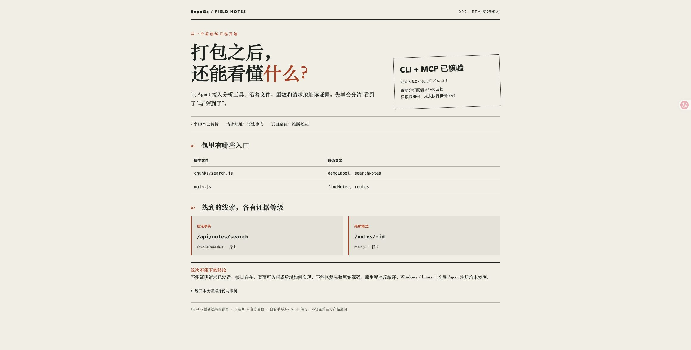
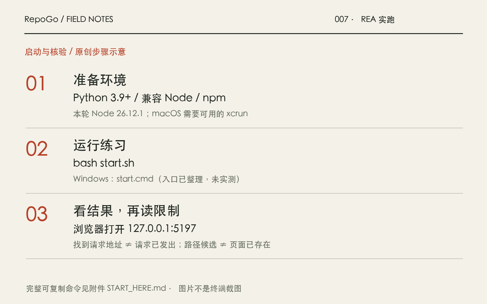

# 从一个自己拥有的练习包开始

REA 是给 AI 助手使用的程序分析工具。逆向分析就是从已交付的程序文件寻找结构和行为线索；它不是“一键拿回完整源码”。本期先看一个完全原创的小练习，不涉及真实第三方产品。



## 你会完成什么

启动器把 `fixture/` 的两段手写 JavaScript 与清单打成 ASAR（把多个文件装在一起的归档），然后分别用命令行与 MCP 分析。MCP 是 AI 助手连接工具的接口；本期通过真正的本地客户端调用它，无需先修改你正在用的 AI 软件。

成功后生成中文结果页：两个脚本的导出、一个语法中出现的请求地址、一个仅属推断的页面路径，以及不能下的结论。样例代码只读不运行；没有后端服务，也不会发送样例里的请求。

## 先准备环境

- Python 3.9+；Windows 需要 `py -3` 可用。
- Node.js 和 npm。REA 6.8.0 官方要求 `^22.23.4 || ^24.22.1 || >=26.12.1`，例如本次实际使用 26.12.1。先执行 `node --version`、`npm --version`。可从 https://nodejs.org/en/download 获取官方版本。
- macOS：本机已有 Apple Command Line Tools；REA 会调用 `xcrun` 编译进程管理辅助程序，需要正常的工具链及缓存写入权限。本轮沙箱禁止缓存写入时确实失败，取得本机执行权限后通过。不要关闭系统安全保护来解决。
- Linux：官方要求 procps 兼容的 `ps`；发行版包名通常为 `procps` / `procps-ng`。本轮未实测。
- 首次联网下载 npm 依赖；本例无需 GPU、模型密钥、Ghidra 或 IDA。若以后让自己的 AI 助手编写分析结论，模型调用可能另计费。

## 启动

把附件解压，进入有 `run.py` 的 `member` 文件夹；Gitee 克隆则直接在仓库根目录操作。

macOS / Linux：

```bash
bash start.sh
```

macOS 也提供 `start.command`；Finder 双击未验证，推荐上面的终端命令。Windows 使用 `start.cmd`，或 PowerShell：

```powershell
py -3 run.py run
py -3 run.py serve
```

首次启动会在当前目录 `.runtime` 安装锁定依赖（不运行依赖安装脚本），分析后停留在本机预览服务。浏览器手动打开 http://127.0.0.1:5197/ 。服务只绑定本机，按 Ctrl+C 停止。

若系统默认 Node 过旧，可以指定已有的新版 Node，不需要改全局安装：

```bash
REPOGO_NODE=/absolute/path/to/node bash start.sh
```

Windows PowerShell 用 `$env:REPOGO_NODE='C:\path\to\node.exe'`，再运行 `start.cmd`。路径要改成自己的真实路径。

## 成功标志

终端显示“分析与核验完成”，页面有 `CLI + MCP 已核验`。检查 `main.js`、`chunks/search.js` 两行；请求地址 `/api/notes/search` 是静态语法事实，`/notes/:id` 保留为推断候选。接口是否存在、请求是否发出、页面能否打开都未知。



当前实测：macOS Apple Silicon，Node 26.12.1，REA 6.8.0。Windows / Linux 提供入口与依赖说明，尚未实测。未验证原生反编译、真实商业程序、混淆代码恢复、全局 AI 客户端注册及公网部署。

下一步看 [DEPLOY.md](DEPLOY.md) 的工具接入与证据文件，再看 [FAQ.md](FAQ.md) 的已遇到错误。
